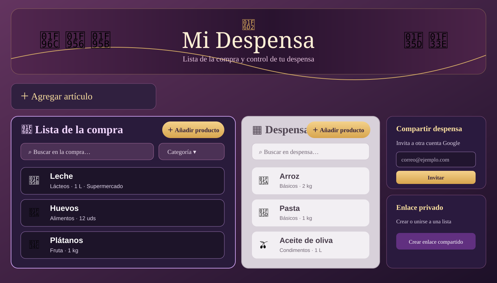
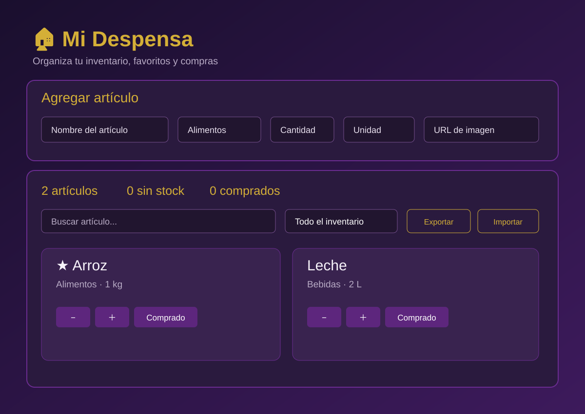
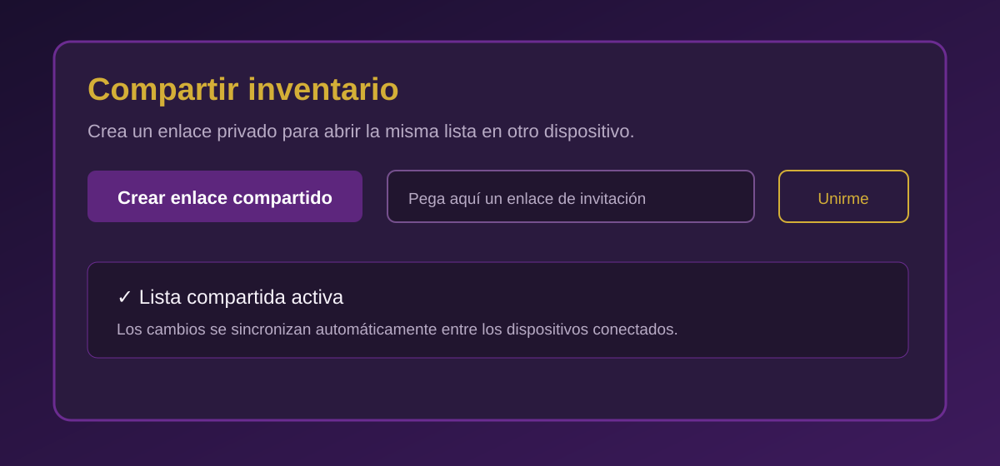

# Mi Despensa

A responsive household pantry and shopping-list app. The live application is available at **[mi-despensa-github.onrender.com](https://mi-despensa-github.onrender.com/)**.

## UI previews

> The SVGs below are illustrative UI previews from the project branch. They are not screenshots of the current live application. Real screenshots will be added here once available.

### Dashboard



### Inventory and sharing





## Features

- Separate shopping and pantry lists, with controls to move items between them.
- Add, edit, search, filter, favorite and remove items.
- Track category, quantity, unit, store and optional product image.
- Sign in with Google and sync a pantry through Supabase.
- Invite another Google account to a shared pantry.
- Use a private legacy sharing link.
- Export and import JSON backups.
- Keep an offline, browser-local inventory when signed out.
- Responsive layout for desktop and mobile.

## Technology

- HTML5, CSS3 and vanilla JavaScript.
- Supabase Auth and Postgres RPC functions for account access and shared data.
- Row-level security (RLS) is enabled for the pantry tables.
- Render Static Sites for the live deployment.

## Run locally

The project is static and does not need a build step. From the repository root, run:

```bash
python -m http.server 8000
```

Then open [http://localhost:8000/app.html](http://localhost:8000/app.html). The landing page is at [http://localhost:8000/](http://localhost:8000/).

Signed-out use stores data in the browser. Google sign-in and cloud sync require a Supabase project.

## Configure Supabase

1. Create a Supabase project and run [`supabase-google-auth.sql`](supabase-google-auth.sql) in its SQL Editor.
2. Enable Google under **Authentication → Providers** and configure the OAuth redirect URLs in Google and Supabase.
3. Set the Supabase project URL and its public client key in the configuration block in `app.html`.
4. Add the local and deployed app URLs to Supabase's allowed redirect URLs.

The browser client key is intended to be public and is protected by database policies. Never place a Supabase `service_role` key, OAuth client secret or other private credential in client-side code or this repository.

## Data and privacy

- Signed-out data stays in that browser's local storage and is not synced across devices.
- Signed-in pantry data is stored in Supabase and shared only through the application's membership checks.
- Invitations are recorded for the invited email; the app does not send an email automatically. Share the app URL separately and ask the invitee to sign in with the invited Google account.
- A legacy private sharing link should be treated like a credential: anyone who has the link may access its associated list.
- Export a JSON backup before clearing browser data or moving to another device.

## Repository contents

```text
.
├── app.html                  # Pantry and shopping-list application
├── index.html                # Landing page
├── styles.css                # Landing-page styles
├── supabase-google-auth.sql  # Supabase schema, RLS and RPC functions
└── docs/                     # Illustrative SVG UI previews
```

## Live app

- Landing page: <https://mi-despensa-github.onrender.com/>
- Application: <https://mi-despensa-github.onrender.com/app.html>

## License

No open-source license is currently included.

---

# Mi Despensa (Español)

Aplicación web responsive para organizar la lista de la compra y controlar la despensa. Permite gestionar productos, sincronizar inventarios con Supabase al iniciar sesión con Google, compartir despensas y exportar copias JSON.

- **Web:** <https://mi-despensa-github.onrender.com/>
- **Aplicación:** <https://mi-despensa-github.onrender.com/app.html>
- **Ejecución local:** `python -m http.server 8000` y abrir `http://localhost:8000/app.html`.

Las imágenes SVG de `docs/` son vistas ilustrativas, no capturas de pantalla de la web publicada.

